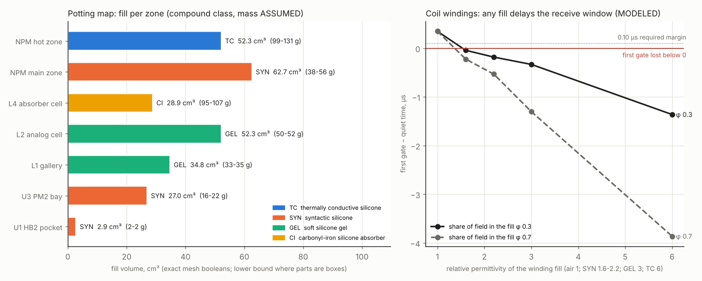

# Potting map (2026-10-28)

MODELED, nothing poured. Generated by `src/mech/potting_map.py` (pipeline step `potting-map`) into `data/results/potting_map.json` and `potting_map.png`.
Volumes are exact mesh booleans where meshes exist (lower bounds where a board's parts are a bounding box). Every compound property is an ASSUMED class range
(ASSUMPTIONS 43): no product is chosen and no compound datasheet is on disk. Replace the ranges with the chosen products' datasheets and re-run (bench test PT1).

## Zones

| Zone | Compound | Volume cm3 | Mass g (ASSUMED density) | Why | Volume source |
|---|---|---|---|---|---|
| NPM hot zone (PB1R FETs, clamp diode, shunt) | TC | 52.3-57.1 | 99-131 | heat to the module wall; HV nodes wetted void-free | potting_volumes.json (exact) |
| NPM main zone | SYN | 62.7-70.6 | 38-56 | light, locks the board and the leads | potting_volumes.json (exact) |
| L4 absorber cell | CI | 28.9 | 95-107 | magnetic absorber (existing design) | potting_volumes.json (exact) |
| L2 analog cell (AB1A / AB1B, FFC links) | GEL | 52.3 | 50-52 | locks boards and links against vibration (microphonics), no hard-resin stress on the precision parts | exact mesh boolean (this script) |
| L1 gallery (RX leads, spine flex start) | GEL | 34.8 | 33-35 | RX leads that move are microphonic noise | exact mesh boolean (core and base plate) |
| U3 PM2 bay (under AU1) | SYN | 27.0 | 16-22 | locks PM2 and the power leads; AU1 stays reachable above (coated) | exact mesh boolean, PM2 as a box (lower bound) |
| U1 HB2 pocket | SYN | 2.9 | 2-2 | locks HB2 and the cord joint; the Hall switch reads through the wall | exact mesh boolean, HB2 as a box (lower bound) |

Totals (lower-bound volumes): head 116.0 cm3 (178-194 g incl. the existing absorber), neck module 114.9 cm3 (137-188 g), upper assembly 29.9 cm3 (18-24 g).

## Compound classes (ASSUMED ranges)

| Code | Class | Density g/cm3 | k W/mK | er | Hardness | Electrical insulator |
|---|---|---|---|---|---|---|
| TC | thermally conductive silicone (alumina / boron-nitride filled) | 1.9-2.3 | 1.0-3.0 | 4.0-6.0 | A 40-70 | yes |
| SYN | syntactic silicone (hollow glass microspheres) | 0.6-0.8 | 0.1-0.2 | 1.6-2.2 | A 20-50 | yes |
| GEL | soft silicone gel (low stress, dielectric gel class) | 0.95-1.0 | 0.15-0.2 | 2.7-3.0 | gel (penetration) | yes |
| CI | carbonyl-iron silicone absorber (existing design) | 3.3-3.7 | 0.5-1.5 | - | A 50-70 | yes |
| CC | conformal coat (silicone or acrylic class), 25-75 um | 1.0-1.1 | - | 2.7-3.5 | film | yes |

## Coil windings: no pour

Decision: **no pour on the windings: lock the turns with a thin SYN bead at the ends only and verify on the bench**. Rule: only a fill that keeps the quiet time >= 0.10 us before the first gate in the whole phi range.
The coil self-capacitance (250 pF of the 500 pF node, ASSUMPTIONS 1) scales with the fill as C (1 + phi (er - 1)); the quiet time comes from the transmit model (boost, 24.5 V).

| Fill | er | phi | Cn pF | Quiet time us | First gate us | Margin us | OK |
|---|---|---|---|---|---|---|---|
| air (no fill) | 1.0 | 0.0 | 500.0 | 5.561 | 5.91 | 0.349 | yes |
| SYN low | 1.6 | 0.3 | 545.0 | 5.951 | 5.91 | -0.041 | no |
| SYN low | 1.6 | 0.7 | 605.0 | 6.131 | 5.91 | -0.221 | no |
| SYN high | 2.2 | 0.3 | 590.0 | 6.091 | 5.91 | -0.181 | no |
| SYN high | 2.2 | 0.7 | 710.0 | 6.441 | 5.91 | -0.531 | no |
| GEL | 3.0 | 0.3 | 650.0 | 6.241 | 5.91 | -0.331 | no |
| GEL | 3.0 | 0.7 | 850.0 | 7.211 | 5.91 | -1.301 | no |
| TC | 6.0 | 0.3 | 875.0 | 7.271 | 5.91 | -1.361 | no |
| TC | 6.0 | 0.7 | 1375.0 | 9.772 | 5.91 | -3.862 | no |

Even the lightest syntactic fill at the low phi bound loses the first gate in the model, so the windings stay unpotted; thin SYN beads at the winding ends lock the turns, and PT2 measures the real C_self and quiet time first.

## Coat only

- L0 SB1R-QA / QB receive boards: RX lobes: a pour adds capacitance to the receive coils (sbq_damp model); coat only
- L5 CB1D: Pico 2 W antenna and 10.2 mm parts under LB1; coat + wire staking
- L6 LB1: LEDs shine through the pixel holes: clear coat only
- L8 cap / HTA board: final bond not specified; coat
- AU1: speaker, jack, selector leads and the SWD pads stay free; coat + staking

## No fill (keep-outs)

- grip channels (U2): cords move with the trigger and the housings
- shaft tube B twin cavity: collapsible shaft: the cords slide
- battery pack U7 and dock U6: removable pack; Li-ion cells need a vent path
- spine duct and comb windows (head): FFC passage (masked insert)
- programming pads (AU1 JSWD, CB1D JDBG): clip-on probe access
- moving parts: trigger, dial, power button, latch: mechanisms

## Checks

- Eddy rule: every filler is an electrical insulator (True); no conductive filler forms a closed loop (CI is an insulated powder in silicone).
- Vault temperature: the unpotted thermal model's worst case is 50.6 C at 40 C ambient (limit 80 C); the thermal model is unpotted air; replacing air (0.026 W/mK) by GEL (0.15-0.2) only adds conduction, so the unpotted worst case is an upper bound.
- High voltage: the NPM hot zone wets DRAIN1 / CLAMP1 and keeps the 1.0 mm board clearances; void-free pours (vacuum degas) are required (PT6, PT7).

## Bench tests that settle the assumptions

| ID | What | Data | How | Pass |
|---|---|---|---|---|
| PT1 | compound properties of the chosen products | density, thermal conductivity, relative permittivity at 100 kHz-1 MHz, dielectric strength, Shore hardness, cure shrinkage, CTE, outgassing | manufacturer datasheets (log in DATASHEET_LOG); replace the ASSUMED class ranges in this script | every zone keeps its function with the real numbers (re-run potting_map.py) |
| PT2 | coil self-capacitance and quiet time, bare vs end-bead lock | C_self of one wound former (impedance analyser, SRF), t_quiet on the bench (scope on the drain and the RX input) | before and after the SYN end beads; then one former test-potted in SYN as a sacrificial sample | t_quiet <= first gate - 0.10 us (fw_timeline.json) with the beads; record the potted sample's delay |
| PT3 | RX microphonics, L1 / L2 unpotted vs GEL | RX output noise during a tap / swing test (fixed tap energy), 10 trials each | AB1 outputs on the logger, head swung on the rig | GEL reduces the tap response; no change of the quiet (no-tap) noise floor |
| PT4 | mass and balance | weight of each poured zone, head and handle mass, balance point on the armrest | scale before / after each pour | within the ranges in this file; balance point recorded |
| PT5 | thermal, NPM hot zone and vault | FET case and hot-zone temperature at boost, 25 / 40 C ambient, 30 min | thermocouples cast in the fill | below the model limits (vault 80 C, PETG); the potted case not hotter than the unpotted model |
| PT6 | high voltage in the NPM fill | hipot DRAIN1 / CLAMP1 to everything at 1 kV (harness test T05/T06), partial discharge if available | after cure, before closing | no breakdown; leakage logged |
| PT7 | voids and adhesion | X-ray or a cut sacrificial sample per compound; adhesion to PETG / FR4 / silicone wire | sample pours with the production degassing | no void at an HV node or a lead exit; no delamination after 10 thermal cycles |
| PT8 | continuity and function after cure | every net continuity (netlist), plane HV keep-outs untouched, ring-down / leak bench items | POTTING_SEQUENCE rule 4 | identical to before the pour |

Order of pours and keep-out masks: docs/delivery/POTTING_SEQUENCE.md. Nothing is poured before the bench items of that sub-assembly (POTTING_SEQUENCE rule 2).
